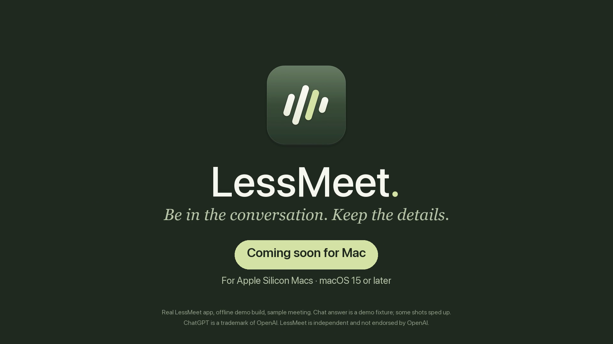

# LessMeet

[](design/promo-video/out/LessMeet-ad-30s-1080p60.mp4)

*Be in the conversation. Keep the details.* ([watch the 30 s video](design/promo-video/out/LessMeet-ad-30s-1080p60.mp4))

Local pivot checkpoint (2026-10-11): LessMeet is moving to a native, open-source
macOS app. The current app shell records locally and uses **Continue with ChatGPT**
for transcript chat. It no longer instantiates the legacy Clerk, Convex or billing
controllers. The native RevenueCat SDK and subscription screen have been removed.
Legacy backend services and saved cloud metadata remain intact.

ChatGPT auth, streaming and local history have offline component tests. The
synthetic account/chat UI subset passed, including saved history after reopening.
Live sign-in/chat and the full app UI are not yet accepted. The shell now shares
the local-model manager and transcription queue. See
[current ownership, evidence and limits](docs/STATUS.md) and the pinned
[local-model contract](docs/LOCAL_MODELS.md). No release or publication is implied.

The current app is local-first. Retained cloud services have separate deployment
and verification checkpoints. Start with these references:

- [Current work and acceptance](docs/STATUS.md).
- [Configuration and secret locations](docs/CONFIGURATION.md).
- [Retained cloud HTTP and deletion contracts](docs/BACKEND.md).
- [Historical internal batch transcription and chat](docs/BATCH_CONTRACT.md).
- [Historical sandbox billing checks](docs/STORE_SANDBOX.md).
- [Approved visual direction](docs/DESIGN.md).

## Run locally

Requires Apple Silicon, macOS 15+, Swift 6.3 with the Swift Build engine, Node 22+, and the
Xcode Metal Toolchain for packaged builds. The build stops if Metal is unavailable.

```sh
swift test --disable-keychain --disable-netrc
xcrun -sdk macosx metal --version
bash scripts/build-app.sh local
open dist/local/LessMeet.app
```

Open `Package.swift` in Xcode to browse/debug. For recording permission checks, use
the packaged `.app`, not `swift run`: the bundle contains the usage descriptions
and hardened-runtime audio-input entitlement. Local builds are ad-hoc signed by
default and cannot verify the current Data Protection Keychain sign-in path.
For profile-backed development builds, use `bash scripts/build-app.sh signed-local`
with an exact `LESSMEET_SIGNING_IDENTITY` SHA1 and `LESSMEET_PROVISIONING_PROFILE`.
The profile must authorize `com.lessmeet.app`; a certificate alone is insufficient.
Output is `dist/signed-local/LessMeet.app`. Existing signed output is never
overwritten. This is device-limited development signing, not public distribution.
See [signing configuration](docs/CONFIGURATION.md#profile-backed-github-zip-signing).
The diagnostic `local` mode uses `com.lessmeet.app.local`, reads no
`.env.local` or cloud service settings, and includes no legacy OAuth URL callback.
ChatGPT uses a temporary loopback listener on `127.0.0.1`.

## Local model setup

The first app launch checks pinned model files and automatically downloads missing
files. The payload is 3,200,167,866 bytes. Allow extra space for partial files and
Core ML caches. Open **Local models** to see progress, cancel, resume or retry.
Failed or cancelled setup does not retry automatically during that app session.
The model cache is `~/Library/Application Support/LessMeet/Models/`.

After **Stop & Save** finishes successfully, LessMeet queues local transcription.
If models are not ready, the job waits for setup. Open **Transcript** to see the
job and saved output. **Transcribe on this Mac** also processes an existing ready
recording. **Cancel all transcription** cancels the active job and pending jobs.
Cancellation or failure preserves a previous saved transcript.

## Chat with a local transcript

1. Open **ChatGPT account** in the sidebar.
2. Choose **Continue with ChatGPT** and finish in your browser.
3. If plan permission was declined, choose **Enable ChatGPT plan usage**.
4. Open a recording with a valid local `transcript.json` and choose **Chat**.
5. Choose **Load models**, then select an available model.
6. Enter a question and choose **Send**, or press **⌘Return**.

Each send includes the full local transcript and the recording's saved chat
history. These go to OpenAI using the selected ChatGPT plan. Audio stays local.
**Manage usage** opens ChatGPT usage settings. No question runs automatically.
Incomplete, canceled or failed answers are not saved. Completed pairs are saved
atomically in `chat.json` and reload when the recording is reopened.

Chat history belongs to the local recording, not an account. Switching accounts
keeps that history; a later send transmits it with the new account. Local files
are not encrypted by LessMeet. Credentials stay in the device-only Keychain.
If local sign-out cleanup fails, retry before quitting. The error disables access
in that process but does not guarantee that credentials are gone after restart.

## Recording

Click **New recording** and grant Microphone and Screen & System Audio Recording
access. If macOS asks for a relaunch, reopen the app and start a new recording.
Click **Stop & Save**, wait for saving, then play or reveal the recording files.
Use headphones to avoid the microphone picking up your speaker output.

System audio means the whole system, excluding LessMeet playback—not a selected
meeting app. No video track is saved. Obtain participants' consent before recording.

Recordings live at `~/Library/Application Support/LessMeet/Recordings/<UUID>/`:

- `recording.json`: title, date, duration and status; legacy fields are preserved.
- `transcript.json`: versioned local segments with timestamps and optional speakers.
- `chat.json`: versioned completed user/assistant pairs for this recording.
- `microphone.caf`, `system.caf`: separate source audio when received.
- `capture-timeline.json`: source offsets for the common timeline.
- `combined.m4a`: derived audio for playback/transcription.

Original audio is retained if combining fails. A recording interrupted by app
termination is marked interrupted when the library is reopened. Automatic repair,
device switching, pause/resume and cloud sync are outside the first version.

Synthetic 30/60/120-minute exports measured 29.56/59.11/118.22 MiB. The historical
18 MiB cloud-upload limit does not apply to local transcription. These export
checks do not establish long-meeting transcription, real-device sound quality or
drift. See the [opt-in test and limits](Tests/LessMeetTests/LONG_CAPTURE_HANDOFF.md)
and the [local-model contract](docs/LOCAL_MODELS.md).

## Legacy account and cloud implementation

The following notes describe the pre-pivot app and retained services. The current
app has no Clerk account, cloud-upload or Plan & usage controls. Use the local
instructions above. Do not use historical instructions as permission to mutate
services. Current service observations and obligations are in
[CONFIGURATION.md](docs/CONFIGURATION.md) and the [HTTP contract](docs/BACKEND.md).

Clerk handles hosted sign-in. Login sessions may use Keychain; Gemini keys never
enter the app. Convex holds the owner-funded Gemini key and checks each request's
owner. Missing `GEMINI_BILLABLE_ENABLED` disables new AI work. Billing and internal
batch gates impose additional checks.

Cloud audio, transcripts and chat remain stored indefinitely unless the deletion
workflow removes them. Account deletion preserves local files and does not cancel
Apple renewal. Provider workers exist, but a local implementation is not proof of
live fulfillment. See the [deletion runbook](docs/legal/DELETION_RUNBOOK.md) for the
accepted scope, seven-calendar-day operating policy and remaining evidence.

Historical Clerk sessions can remain in Keychain. Native cleanup does not delete
them or change provider data.

The current app cannot purchase or restore RevenueCat subscriptions. SDK removal
does not cancel subscriptions or delete customers. Backend billing, provider
deletion and historical operator contracts remain. See
[billing obligations](docs/BACKEND.md#subscription-integration-development-sandbox-production-pending).
Store/TestFlight tooling retains its approval gates; those gates do not establish
that the current app supports the old billing product.

Before building, set public `CLERK_PUBLISHABLE_KEY` and `CONVEX_SITE_URL` in ignored
`.env.local`. The packaging script copies only allowlisted public values into Info.plist.
Missing account configuration does not prevent local recording. Clerk requires
Native API enabled, `com.lessmeet.app://callback` registered, and session claim
`aud: convex`. Convex uses `CLERK_JWT_ISSUER_DOMAIN` for the Clerk issuer.
Production Google/Apple provider credentials and distribution signing are separate
setup; development shared OAuth credentials do not establish production readiness.

### Historical cloud transcript and chat

1. Connect your account from the sidebar and sign in if needed.
2. Select a saved recording and choose **Create Transcript**.
3. Review the upload notice, then choose **Upload and Create Transcript**.
4. After reopening or a connection failure, use **Refresh** before continuing.
5. When the batch is complete and chat is available, enter a question and choose **Send**.

The app derives chunks from `combined.m4a`: at most five minutes each, with
five-second overlap, a 120-minute source cap and an 18 MiB cap per chunk. Originals
stay on the Mac. It saves the batch identity and manifest before the first request.
The backend requires an enabled, exact-owner-allowlisted internal batch service;
chat has a separate gate and requires complete results that fit its context limit.
For example, a 600-second source produces three chunks starting at 0, 295 and
590 seconds. The five-second overlap accounts for the third, ten-second chunk.

Saved legacy single-upload transcripts and their chat remain separate. Results
are stored per backend and Clerk account. Signing out hides cloud caches but keeps
local recordings. These caches are not encrypted by the app and do not protect
data from the macOS user. See the [batch contract](docs/BATCH_CONTRACT.md) for
recovery, partial results and explicit retry rules.

**Meeting notes → Summarize / Action items** prepares a grounded question in the
composer; review and Send explicitly. Each successful request consumes one AI
question when quotas are enabled, with the result saved in the conversation.

**Stop Waiting** cancels local waiting, not work already accepted by the server.
Batch recovery uses the saved identity. Unknown generation is not automatically
retried. The legacy single-upload route cannot recover an upload whose response
was lost before its remote ID was saved. Resubmitting it may incur another charge.
Failed or oversized uploads never replace local audio.

### Historical Convex development setup

Project: [hoang-bang/lessmeet](https://dashboard.convex.dev/t/hoang-bang/lessmeet).
Historical dev deployment: `zany-octopus-315` (US East). This setup snippet is
not a current deployment inventory. See CONFIGURATION.md before operator work.

```sh
npm ci
npx convex deployment select hoang-bang:lessmeet:dev/lessmeet
npx convex env set GEMINI_API_KEY
npx convex env list --names-only
```

Enter the key through the CLI prompt or the deployment dashboard's Environment
Variables page. Do not put it in Swift, source files, shell arguments or chat.
Environment variables are deployment-specific. Local Convex selection is kept in
ignored `.env.local`. The owner has set `GEMINI_API_KEY`; only its existence was
checked, never its value.

The backend uses the Vercel AI SDK Google provider. The default model is
`gemini-flash-latest`, with a server-side `GEMINI_MODEL` override. Native requests
use the [HTTP contract](docs/BACKEND.md), not a Convex Swift SDK integration.

## Verification and next checks

Backend: run `npm run typecheck:backend` and `npm run test:backend`.
Tests cover anonymous/cross-user rejection, owner upload/transcript/chat with a
mocked provider, and the actual pinned SDK request format using mocked HTTP.
These automated checks use no live Gemini request. Separately, Human reported one
successful end-to-end round and core sandbox billing checks; this does not establish
the current release binary's complete runtime matrix or production readiness.

`swift test` exercises persistence/reopen and synthetic sample buffers through the
real CAF/M4A writer/exporter. These do not prove live capture, acoustic quality,
long-session synchronization, TCC behavior, or macOS 15 runtime compatibility.
The native suite includes local transcription/chat, HTTP contract, retained cloud
lifecycle, persistence and local rendering checks. Billing-only tests and the
`LESSMEET_SUBSCRIPTION_SNAPSHOT` fixture were retired with the native SDK.
Exact current acceptance
results are in STATUS.md. No real OAuth or paid Gemini call was used for these tests.

Before considering the recorder verified, record a short known conversation with
mic-only, system-only and overlapping speech, including a long pause in playback.
Stop, quit, reopen and listen to the beginning/end and both source files. Repeat
with denied permissions. Test on the intended microphone/headphones.

### Agent native UI checks

Use the current packaged local app for current-app UI acceptance. The repeatable
Xcode suite below covers the retained legacy account-deletion fixture only:

```sh
bash scripts/test-ui.sh
```

The runner saves an Xcode `.xcresult` report, screenshots, accessibility text and
build/test logs under ignored `.artifacts/verify-lessmeet/`. It checks account
refresh, failures, delayed responses, account switching and confirmation without
live accounts or paid calls. It requires a logged-in macOS desktop and UI automation
permissions. See [Xcode testing and debugging](Tests/UI/README.md) for the shared
Xcode scheme, model/component debugging and proof limits. These fixture tests do
not establish live recording, cloud or billing behavior.

Use the project skill [lessmeet-app-check](.agents/skills/lessmeet-app-check/SKILL.md)
for native UI diagnosis and verification. `AGENTS.md` defines when it is required.
The skill contains the Computer Use procedure, evidence requirements and limits.

#### Checks without Keychain

Build the isolated fixture app:

```sh
bash scripts/build-app.sh offline-check
open dist/offline-check/LessMeet.app
```

This build uses `LESSMEET_OFFLINE_CHECK` at compile time. Its entry point never
creates Clerk, a recording library, a cloud client or billing. It uses a separate
bundle ID, `com.lessmeet.app.offline-check`, and no OAuth callback. Packaging
ignores `.env.local` and service configuration from the environment. A runtime
environment variable cannot enable the fixture entry point in a normal build.
Offline packaging always uses ad-hoc signing. It ignores an inherited signing
identity so the build does not need to unlock a private signing key.

1. Select a synthetic response.
2. Click **Refresh deletion status**.
3. Check the applied response or synthetic error.
4. For **Wait for response**, click **Complete pending response** to finish it.
5. To check stale-response handling, select **Wait for response**, click Refresh,
   then click **Switch synthetic account**. The previous response must not apply.

The fixture shares the real deletion view/model. Delete and subscription links
are disabled or absent. These checks do not verify OAuth, Keychain permissions,
HTTP transport, billing, recording or production deletion.

#### Historical Clerk account connection

This procedure applies only to a pre-pivot artifact with **Connect Account**.
The current app uses **ChatGPT account**. `auth-check` packaging does not restore
the removed Clerk controls and is not the ChatGPT verification route.

Normal app startup stays local. Opening Account does not access Clerk. Click
**Connect Account** to restore the saved session, then sign in if needed.
This does not sign out or delete the saved session between launches.
Clerk 1.5.5 still reads Keychain synchronously on the main thread when connecting.
The connection can wait for a macOS prompt; it is not a background-safe SDK call.

For live auth checks, use `bash scripts/build-app.sh auth-check --preflight`
before building with `bash scripts/build-app.sh auth-check`. This mode requires
an explicit `LESSMEET_SIGNING_IDENTITY` other than `-` and explicit public
`CLERK_PUBLISHABLE_KEY` and `CONVEX_SITE_URL` values. It does not read `.env.local`.
Use the same approved signing identity across trial builds. A switch from an
ad-hoc signature can still require one new Keychain authorization. A valid
signature alone does not prove the item allows access. Do not change profiles,
Keychain access rules or production configuration to make a check pass.

If connection stalls:

1. Identify the exact running app path and signing requirement with
   `codesign -d -r- --verbose=4 /absolute/path/to/LessMeet.app`.
2. Inspect a short stack sample of that exact process. Distinguish a Keychain
   wait from an ordinary event loop or a Computer Use connection failure.
3. Inspect the current system prompt through Computer Use if available. Do not
   repeat timed-out clicks or infer permission denial from a timeout.
4. If authorization is needed, ask the operator to approve only the identified
   app/item. The operator enters any password directly; never request it in chat.
5. Read fresh app state after the operator action, then resume the bounded check.

Do not reset Keychain, delete cached sessions or grant blanket access. Continue
offline work while live auth is blocked. Record live results as UNVERIFIED until
the exact artifact and requested behavior have runtime evidence.
